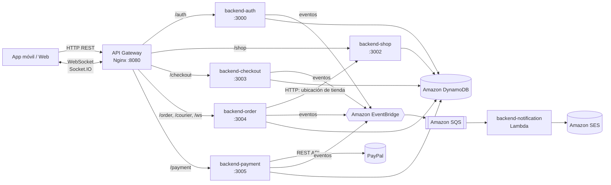
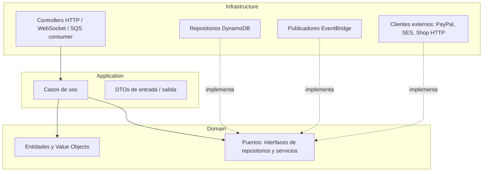
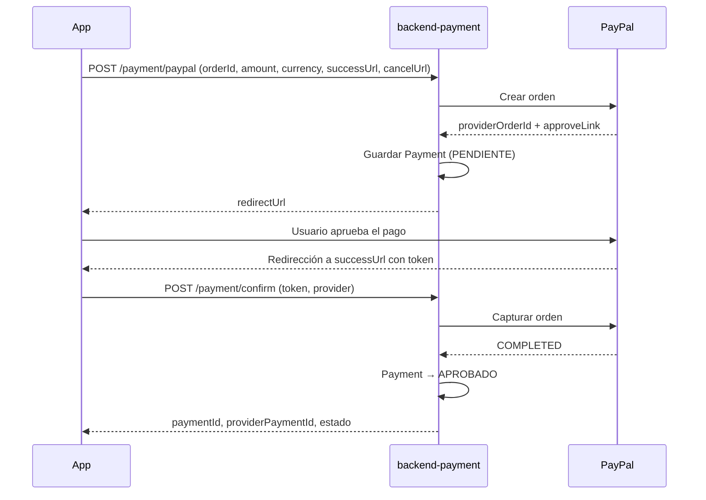
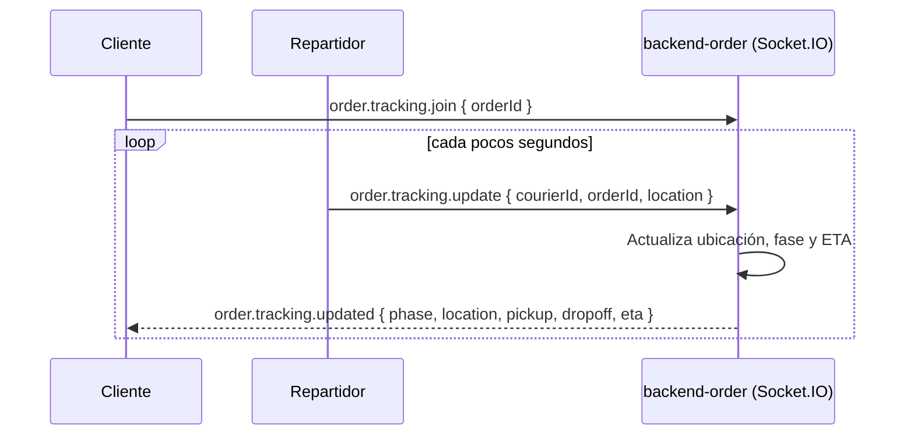
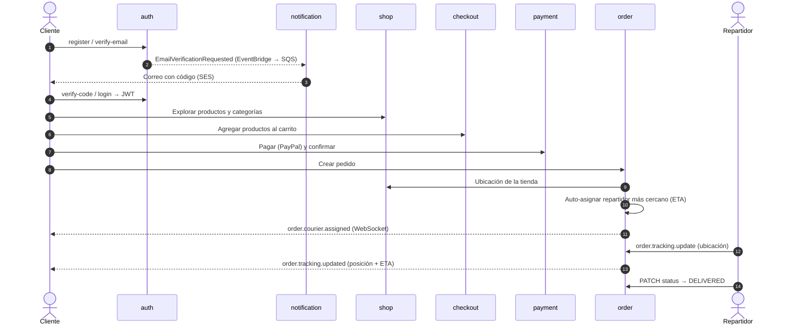

# FoodStore — Backend Delivery

Backend de la plataforma de delivery **FoodStore**, construido como un conjunto de **microservicios NestJS (TypeScript)** desplegables tanto en contenedores Docker (desarrollo local) como en **AWS Lambda** (producción). Cubre el ciclo completo de un pedido de comida: registro y autenticación del cliente, catálogo de productos, carrito de compras, pago, creación del pedido, asignación automática de repartidor, seguimiento en tiempo real y notificaciones por correo.

---

## Tabla de contenidos

1. [Arquitectura general](#arquitectura-general)
2. [Stack tecnológico](#stack-tecnológico)
3. [Estructura del repositorio](#estructura-del-repositorio)
4. [Arquitectura interna de cada microservicio](#arquitectura-interna-de-cada-microservicio)
5. [Microservicios](#microservicios)
   - [backend-auth](#backend-auth--autenticación-y-usuarios)
   - [backend-shop](#backend-shop--catálogo)
   - [backend-checkout](#backend-checkout--carrito-de-compras)
   - [backend-payment](#backend-payment--pagos)
   - [backend-order](#backend-order--pedidos-repartidores-y-tracking)
   - [backend-notification](#backend-notification--notificaciones)
6. [Flujo de negocio de extremo a extremo](#flujo-de-negocio-de-extremo-a-extremo)
7. [Comunicación entre servicios](#comunicación-entre-servicios)
8. [Persistencia (DynamoDB)](#persistencia-dynamodb)
9. [Convenciones de la API](#convenciones-de-la-api)
10. [API Gateway local (Nginx)](#api-gateway-local-nginx)
11. [Configuración y variables de entorno](#configuración-y-variables-de-entorno)
12. [Ejecución local](#ejecución-local)
13. [Despliegue (CI/CD a AWS Lambda)](#despliegue-cicd-a-aws-lambda)
14. [Calidad de código](#calidad-de-código)
15. [Estado actual y limitaciones conocidas](#estado-actual-y-limitaciones-conocidas)
16. [Hoja de ruta](#hoja-de-ruta)

---

## Arquitectura general



Principios de diseño:

- **Microservicios por contexto de negocio** (Bounded Contexts): cada servicio es dueño de sus datos y de sus tablas en DynamoDB.
- **Arquitectura Hexagonal / Clean Architecture** en cada servicio: `domain` → `application` → `infrastructure`.
- **Comunicación asíncrona orientada a eventos** mediante Amazon EventBridge + SQS, y **síncrona** vía HTTP solo cuando se requiere una respuesta inmediata.
- **Dual runtime**: el mismo código se ejecuta como servidor HTTP tradicional (`main.ts`) o como función Lambda (`handler.ts`).
- **Tiempo real** con WebSockets (Socket.IO) para el seguimiento del repartidor.

---

## Stack tecnológico

| Categoría | Tecnología |
|---|---|
| Lenguaje | TypeScript |
| Framework | NestJS 10 (`@nestjs/core`, `@nestjs/config`, `@nestjs/platform-express`) |
| Validación | `class-validator`, `class-transformer` |
| Autenticación | JWT (`jsonwebtoken`, `passport-jwt`), `bcrypt` |
| Tiempo real | `@nestjs/websockets`, `socket.io` |
| Base de datos | Amazon DynamoDB (`@aws-sdk/client-dynamodb`, `@aws-sdk/lib-dynamodb`) |
| Mensajería | Amazon EventBridge, Amazon SQS |
| Correo | Amazon SES |
| Pagos | PayPal Orders API v2 (Stripe en planificación) |
| Serverless | AWS Lambda + `aws-serverless-express` |
| Contenedores | Docker (Node 20 Alpine, build multi-stage), Docker Compose |
| Gateway local | Nginx, ngrok (exposición pública para pruebas / webhooks) |
| CI/CD | AWS CodeBuild (`buildspec.yml`) + S3 |
| Calidad | ESLint, Prettier, Jest, SonarQube |

---

## Estructura del repositorio

```text
backend-delivery/
├── backend-auth/            # Autenticación, usuarios y preferencias
├── backend-shop/            # Catálogo: productos, categorías y tiendas
├── backend-checkout/        # Carrito de compras
├── backend-payment/         # Pagos (PayPal; Stripe en desarrollo)
├── backend-order/           # Pedidos, repartidores, asignación y tracking en tiempo real
├── backend-notification/    # Envío de correos (consumidor SQS → SES)
├── docker-compose.yaml      # Orquestación local de todos los servicios + gateway + ngrok
├── nginx.conf               # Reglas de enrutamiento del API Gateway local
├── pagos_nativos.md         # Documento de diseño: migración a pagos nativos con Stripe
└── README.md
```

Cada microservicio es un proyecto NestJS independiente con su propio `package.json`, `Dockerfile`, `buildspec.yml` y configuración de TypeScript:

```text
backend-<servicio>/
├── src/
│   ├── domain/              # Entidades, value objects, puertos (interfaces), constantes
│   ├── application/         # Casos de uso, DTOs, excepciones de aplicación, eventos
│   ├── infrastructure/      # Controladores, repositorios DynamoDB, clientes externos, filtros
│   ├── <servicio>.module.ts # Módulo NestJS: inyección de dependencias (puerto → adaptador)
│   ├── setup.ts             # Configuración global: pipes, interceptores, filtros, CORS
│   ├── main.ts              # Entrada como servidor HTTP (local / Docker)
│   └── handler.ts           # Entrada como AWS Lambda
├── Dockerfile               # Imagen multi-stage para ejecución local
├── buildspec.yml            # Pipeline de AWS CodeBuild para desplegar en Lambda
├── tsconfig.json            # Configuración base
├── tsconfig.build.json      # Build para contenedor  → .build/
├── tsconfig.lambda.json     # Build para Lambda      → .build-lambda/
├── sonar-project.js         # Análisis estático con SonarQube
└── .env.example             # Plantilla de variables de entorno
```

---

## Arquitectura interna de cada microservicio

Todos los servicios siguen la misma organización en capas, basada en **Arquitectura Hexagonal (Puertos y Adaptadores)**:



| Capa | Responsabilidad | Ejemplos |
|---|---|---|
| **Domain** | Reglas de negocio puras, sin dependencias de frameworks ni de AWS. Define las entidades y los *puertos* (interfaces) que la aplicación necesita. | `Order`, `Courier`, `Cart`, `Payment`, `User`, `OrderRepository`, `EtaService` |
| **Application** | Orquesta los casos de uso: recibe DTOs validados, invoca al dominio y a los puertos. | `CreateOrderUseCase`, `AutoAssignCourierUseCase`, `ConfirmPaymentUseCase` |
| **Infrastructure** | Adaptadores concretos: controladores, persistencia, mensajería, integraciones externas. | `OrderRepositoryImpl` (DynamoDB), `EventBridgeOrderEventPublisherImpl`, `PaypalPaymentGatewayImpl` |

La inversión de dependencias se resuelve en el módulo NestJS mediante **tokens `Symbol`**:

```ts
{ provide: OrderRepositorySymbol, useClass: OrderRepositoryImpl }
```

Esto permite sustituir cualquier adaptador (por ejemplo, otra base de datos o pasarela de pago) sin tocar el dominio ni los casos de uso.

**Elementos transversales** (configurados en `setup.ts`):

- `ValidationPipe` global con `whitelist` y `forbidNonWhitelisted`: rechaza cualquier propiedad no declarada en el DTO.
- `TransformInterceptor`: desenvuelve el sobre `Data` de las peticiones y envuelve todas las respuestas en `{ Data: ... }`; registra la duración de cada petición HTTP y mensaje WebSocket.
- `HttpErrorFilter`: normaliza los errores en un formato de respuesta uniforme.
- Jerarquía de excepciones propia por capa (`ApplicationException`, `InfrastructureException`) con mensajes de dominio centralizados en `domain/constants/messages.ts`.
- CORS habilitado.

---

## Microservicios

### backend-auth — Autenticación y usuarios

Gestiona el registro, inicio de sesión, verificación de correo mediante código y las preferencias del usuario.

**Funcionalidad principal**

- Registro de usuarios con contraseña cifrada con **bcrypt** (10 rondas).
- Emisión de **access token** (JWT, 15 min) y **refresh token** (JWT, 7 días).
- Verificación de email con **código de 4 dígitos** y expiración de **4 minutos**; el envío del correo se delega a `backend-notification` publicando un evento.
- Establecimiento / cambio de contraseña.
- Preferencias del usuario.
- Endpoint protegido `GET /auth/me` mediante `AccessTokenGuard` (Passport JWT) y el decorador `@CurrentUser()`.

**Endpoints**

| Método | Ruta | Descripción |
|---|---|---|
| `POST` | `/auth/register` | Registra un usuario y devuelve los tokens. Publica `UserRegistered`. |
| `POST` | `/auth/login` | Autentica con email y contraseña. |
| `POST` | `/auth/verify-email` | Genera un código de verificación y publica `EmailVerificationRequested`. |
| `POST` | `/auth/verify-code` | Valida el código y activa la cuenta. |
| `POST` | `/auth/set-password` | Establece una nueva contraseña. |
| `GET` | `/auth/me` | Datos del usuario autenticado (requiere `Authorization: Bearer <token>`). |
| `GET` | `/auth/users` | Lista paginada de usuarios. |
| `GET` | `/auth/users/:id` | Detalle de un usuario. |
| `POST` | `/auth/preferences` | Registra preferencias. |
| `GET` | `/auth/preferences` | Lista paginada de preferencias. |

**Eventos publicados** (`Source: auth-service`): `UserRegistered`, `EmailVerificationRequested`.

**Tablas**: `Users` (índices `EmailIndex`, `GSI_USER`), `Preferences` (índice `GSI_USER`).

---

### backend-shop — Catálogo

Administra el catálogo de la tienda.

**Funcionalidad principal**

- Productos con precio, stock, SKU, imagen, categoría, tienda asociada e **ingredientes** (value object `Ingredient` con cantidad y unidad: `g`, `kg`, `ml`, `l`, `unit`).
- Categorías de productos.
- Consulta de la ubicación de una tienda (usada por `backend-order` como punto de recogida).

**Endpoints**

| Método | Ruta | Descripción |
|---|---|---|
| `POST` | `/shop/products` | Crea un producto. |
| `GET` | `/shop/products` | Lista paginada de productos (filtrable por categoría). |
| `GET` | `/shop/products/:id` | Detalle de un producto. |
| `POST` | `/shop/categories` | Crea una categoría. |
| `GET` | `/shop/categories` | Lista paginada de categorías. |
| `GET` | `/shop/stores/:id/location` | Coordenadas (`lat`, `lng`) de la tienda. |

**Tablas**: `Products` (índice `GSI_CATEGORY`), `Categories`.

---

### backend-checkout — Carrito de compras

Mantiene un carrito por usuario.

**Funcionalidad principal**

- Agregar productos al carrito: si el producto ya existe, **incrementa la cantidad** en lugar de duplicarlo.
- Consultar, eliminar ítems individuales y vaciar el carrito.
- Cálculo del total del carrito en la entidad de dominio `Cart`.
- Publicación de eventos de dominio con un sobre estándar (`eventId`, `eventName`, `occurredOn`, `payload`).

**Endpoints**

| Método | Ruta | Descripción |
|---|---|---|
| `POST` | `/checkout/carts/:userId/items` | Agrega un ítem al carrito del usuario. |
| `GET` | `/checkout/carts/:userId` | Obtiene el carrito del usuario. |
| `DELETE` | `/checkout/carts/:userId/items/:productId` | Elimina un producto del carrito. |
| `DELETE` | `/checkout/carts/:userId` | Vacía el carrito. |

**Eventos** (`Source: cart-service`): `CartItemAdded`, `CartItemRemoved`, `CartCleared`, `CartUpdated`.

**Tabla**: `Carts` (configurable con `CART_TABLE`, índice `GSI_UserId`).

---

### backend-payment — Pagos

Integra pasarelas de pago y registra cada transacción.

**Funcionalidad principal**

- Creación de órdenes de pago en **PayPal** (Orders API v2; sandbox o producción según `PAYPAL_ENV`), devolviendo la URL de aprobación (`redirectUrl`) a la que se redirige al usuario.
- Confirmación / **captura** del pago con el `token` devuelto por PayPal tras la aprobación.
- Máquina de estados de la entidad `Payment`: `PENDIENTE → APROBADO | FALLIDO | CANCELADO`, con protección contra transiciones desde un estado final.
- Consulta paginada de pagos.
- Base preparada para **Stripe** (ver [`pagos_nativos.md`](pagos_nativos.md)).

**Endpoints**

| Método | Ruta | Descripción |
|---|---|---|
| `POST` | `/payment/paypal` | Crea la orden en PayPal y registra el pago `PENDIENTE`. Devuelve `paymentId`, `providerOrderId` y `redirectUrl`. |
| `POST` | `/payment/confirm` | Captura el pago en PayPal y lo marca como `APROBADO` o `FALLIDO`. |
| `POST` | `/payment` | Registra un pago genérico. |
| `GET` | `/payment` | Lista paginada de pagos. |

**Flujo PayPal**



**Tabla**: `Payments` — claves `PK/SK` (`PAYMENT#<id>` / `METADATA`) e índices `GSI_PAYMENT` (listado de pagos) y `GSI_PROVIDER_TOKEN` (búsqueda por token del proveedor).

---

### backend-order — Pedidos, repartidores y tracking

Es el núcleo logístico. Contiene dos módulos: **Order** y **Courier**, además de un **gateway WebSocket** para el seguimiento en tiempo real.

**Funcionalidad principal**

- **Creación de pedidos**: obtiene la ubicación de la tienda desde `backend-shop` (punto de recogida), calcula el total a partir de los ítems y persiste el pedido.
- **Asignación automática de repartidor** al crear el pedido:
  1. Busca repartidores `AVAILABLE` con ubicación reciente (≤ `COURIER_MAX_LOCATION_AGE_SECONDS`, por defecto 120 s), hasta `COURIER_AUTO_ASSIGN_MAX_CANDIDATES` candidatos (por defecto 25).
  2. Calcula el ETA de cada candidato hasta la tienda.
  3. Asigna al de **menor ETA** (desempate por distancia) y notifica por WebSocket.
- **Asignación manual** de un repartidor a un pedido.
- **Ciclo de vida de la entrega** con dos dimensiones de estado:
  - Estado de pago del pedido: `PENDING`, `PAID`, `FAILED`, `CANCELLED`.
  - Estado de entrega: `CREATED → ASSIGNED → PREPARING → PICKED_UP → ON_THE_WAY → DELIVERED` (o `CANCELED`).
  - Fase derivada para el tracking: `TO_PICKUP` (hacia la tienda) / `TO_DROPOFF` (hacia el cliente) / `DELIVERED`.
- **Gestión de repartidores**: alta, consulta, disponibilidad (`AVAILABLE`, `BUSY`, `OFFLINE`), tipo de vehículo (`BIKE`, `MOTO`, `CAR`) y última ubicación conocida.
- **Cálculo de ETA** (`EtaServiceImpl`): distancia por **fórmula de Haversine** y velocidad media de 25 km/h. Está desacoplado tras el puerto `EtaService`, por lo que puede reemplazarse por un proveedor de rutas real.
- **Tracking en tiempo real** por Socket.IO, usando una *room* por pedido (`order-tracking-<orderId>`).

**Endpoints REST**

| Método | Ruta | Descripción |
|---|---|---|
| `POST` | `/order` | Crea un pedido y dispara la asignación automática de repartidor. |
| `GET` | `/order` | Lista paginada de pedidos. |
| `GET` | `/order/:id` | Detalle de un pedido. |
| `PATCH` | `/order/:orderId/status` | Actualiza el estado de entrega. |
| `GET` | `/order/:orderId/status-delivery` | Consulta el estado de entrega. |
| `GET` | `/order/:orderId/assign/:courierId` | Asigna manualmente un repartidor. |
| `POST` | `/courier` | Registra un repartidor (inicia en `OFFLINE`). |
| `GET` | `/courier` | Lista paginada de repartidores. |
| `GET` | `/courier/:courierId` | Detalle de un repartidor. |
| `PATCH` | `/courier/:courierId/presence` | Actualiza la ubicación y disponibilidad del repartidor (*heartbeat*). |

**Eventos WebSocket**

| Dirección | Evento | Emisor | Descripción |
|---|---|---|---|
| Cliente → Servidor | `order.tracking.join` | App del cliente | Se suscribe al tracking de `{ orderId }`. |
| Cliente → Servidor | `order.tracking.leave` | App del cliente | Cancela la suscripción. |
| Cliente → Servidor | `order.tracking.update` | App del repartidor | Envía `{ Data: { Courier: { courierId, orderId, location: { lat, lng } } } }`. |
| Servidor → Cliente | `order.courier.assigned` | Servidor | Repartidor asignado al pedido. |
| Servidor → Cliente | `order.tracking.updated` | Servidor | Posición actual, fase, puntos de recogida/entrega y ETA. |



**Simulador de repartidor**

Para pruebas sin dispositivo móvil, el script `scripts/courier-presence-simulator.js` envía periódicamente la presencia de un repartidor recorriendo una ruta:

```bash
cd backend-order
SIM_BASE_URL=http://localhost:3004 \
SIM_COURIER_ID=<courierId> \
SIM_INTERVAL_MS=3000 \
SIM_STATUS=AVAILABLE \
SIM_POINTS="-11.981,-77.083;-11.982,-77.084" \
npm run simulate:courier
```

**Tablas**: `Orders` (índice `GSI_ORDER`), `Couriers` (índice `GSI_COURIER`).

---

### backend-notification — Notificaciones

Servicio *event-driven* sin API pública: se ejecuta como **Lambda disparada por SQS**.

**Funcionalidad principal**

- Consume mensajes de SQS que contienen eventos de EventBridge (por ejemplo, `EmailVerificationRequested`).
- Extrae `email`, `subject` y `message` del `detail.payload` del evento.
- Envía el correo mediante **Amazon SES** desde la dirección configurada en `SES_SOURCE_EMAIL`.

**Modo local**: expone `POST /notification/send-email`, que construye un evento SQS simulado (`fake-event.ts`) para probar el flujo completo sin AWS SQS.

---

## Flujo de negocio de extremo a extremo



---

## Comunicación entre servicios

| Tipo | Origen → Destino | Mecanismo | Uso |
|---|---|---|---|
| Síncrona | order → shop | HTTP (axios, timeout 3 s) | Obtener la ubicación de la tienda para el pedido. |
| Síncrona | payment → PayPal | HTTPS REST | Crear y capturar órdenes de pago. |
| Asíncrona | auth, checkout, order, payment → EventBridge | `PutEvents` sobre el bus `EVENT_BUS_NAME` | Publicación de eventos de dominio. |
| Asíncrona | EventBridge → SQS → notification | Regla de EventBridge + cola SQS | Envío de correos. |
| Tiempo real | order ↔ apps | Socket.IO | Tracking del repartidor. |

---

## Persistencia (DynamoDB)

Cada servicio es dueño exclusivo de sus tablas:

| Servicio | Tabla | Índices secundarios |
|---|---|---|
| auth | `Users` | `EmailIndex`, `GSI_USER` |
| auth | `Preferences` | `GSI_USER` |
| shop | `Products` | `GSI_CATEGORY` |
| shop | `Categories` | — |
| checkout | `Carts` | `GSI_UserId` |
| order | `Orders` | `GSI_ORDER` |
| order | `Couriers` | `GSI_COURIER` |
| payment | `Payments` | `GSI_PAYMENT`, `GSI_PROVIDER_TOKEN` |

- Las entidades exponen `toPrimitives()` / `fromPrimitives()` para mapear entre el modelo de dominio y el ítem de DynamoDB.
- Los listados usan **paginación por cursor** (`nextCursor`, basado en `LastEvaluatedKey`).
- Se aplica **borrado lógico** mediante el campo `deletedAt`.

---

## Convenciones de la API

**Sobre de petición y respuesta.** Todas las peticiones pueden enviarse envueltas en `Data`, y el cuerpo se agrupa por entidad (`User`, `Auth`, `Cart`, `Order`, `Courier`, `Payment`, `Product`):

```json
{
  "Data": {
    "Order": {
      "userId": "8d1c...",
      "storeId": "store-01",
      "deliveryLat": -11.9811,
      "deliveryLng": -77.0832,
      "items": [
        { "productId": "p-01", "name": "Pizza", "price": 35.5, "quantity": 2 }
      ]
    }
  }
}
```

Respuesta simple:

```json
{
  "Data": {
    "order": { "orderId": "f3a1..." },
    "statusCode": 200,
    "message": "..."
  }
}
```

Respuesta paginada:

```json
{
  "Data": {
    "items": [],
    "count": 10,
    "nextCursor": "eyJ...",
    "statusCode": 200,
    "message": "..."
  }
}
```

**Autenticación.** Los endpoints protegidos esperan el encabezado `Authorization: Bearer <accessToken>`.

---

## API Gateway local (Nginx)

`nginx.conf` publica todos los servicios bajo un único punto de entrada (`http://localhost:8080`):

| Prefijo | Servicio destino |
|---|---|
| `/auth/` | backend-auth (`auth:3000`) |
| `/shop/` | backend-shop (`shop:3002`) |
| `/checkout/` | backend-checkout (`checkout:3003`) |
| `/order/` | backend-order (`order:3004`) |
| `/courier/` | backend-order (`order:3004`) |
| `/payment/` | backend-payment (`payment:3005`) |
| `/ws/` | backend-order (WebSocket, con *upgrade* de conexión HTTP/1.1) |

El contenedor **ngrok** expone el gateway en una URL pública (panel de inspección en `http://localhost:4040`), útil para probar desde un dispositivo móvil o recibir redirecciones / webhooks de PayPal.

---

## Configuración y variables de entorno

Cada servicio carga `.env.${NODE_ENV}`. Sin `NODE_ENV` carga **`.env.local`** (LocalStack); con `NODE_ENV=production`, **`.env.production`** (AWS). Las plantillas `.env.local.example` y `.env.production.example` sí se versionan; los archivos reales están en `.gitignore`. En Lambda las variables las define Terraform.

| Variable | Servicios | Descripción |
|---|---|---|
| `PORT` | todos | Puerto HTTP del servicio. |
| `NODE_ENV` | todos | Entorno de ejecución. |
| `AWS_REGION` / `REGION` | todos | Región de AWS. |
| `AWS_LOCAL` | todos excepto notification | Si es `true`, usa credenciales explícitas (`AWS_ACCESS_KEY_ID` / `AWS_SECRET_ACCESS_KEY`); si no, la cadena de credenciales por defecto (rol IAM de la Lambda o `~/.aws`). |
| `AWS_ACCESS_KEY_ID`, `AWS_SECRET_ACCESS_KEY` | todos excepto notification | Credenciales para desarrollo local. |
| `EVENT_BUS_NAME` | auth, checkout, order, payment | Nombre del bus de EventBridge. |
| `JWT_PRIVATE_KEY` | auth | Clave privada RS256 para firmar access tokens (solo auth). |
| `JWT_PUBLIC_KEY`, `JWT_ISSUER`, `JWT_AUDIENCE` | todos excepto notification | Verificación de los access tokens. |
| `INTERNAL_API_KEY` | todos excepto notification | Clave de los endpoints de administración (`X-Internal-Api-Key`). |
| `CORS_ORIGINS` | todos excepto notification | Orígenes web permitidos, separados por coma. |
| `AWS_ENDPOINT_URL` | todos | Endpoint de AWS. En local apunta a LocalStack (`http://localhost:4566`). |
| `CART_TABLE` | checkout | Nombre de la tabla del carrito (por defecto `Carts`). |
| `SHOP_MS_BASE_URL` | order | URL base de backend-shop, incluyendo el prefijo `/shop` (p. ej. `http://localhost:3002/shop`). |
| `COURIER_MAX_LOCATION_AGE_SECONDS` | order | Antigüedad máxima de la ubicación de un repartidor para ser candidato (por defecto `120`). |
| `COURIER_AUTO_ASSIGN_MAX_CANDIDATES` | order | Número máximo de candidatos evaluados (por defecto `25`). |
| `SIM_*` | order | Parámetros del simulador de repartidor. |
| `PAYPAL_CLIENT_ID`, `PAYPAL_CLIENT_SECRET` | payment | Credenciales de PayPal. |
| `PAYPAL_ENV` | payment | `production` para la API real; cualquier otro valor usa sandbox. |
| `SES_SOURCE_EMAIL` | notification | Remitente verificado en Amazon SES. |

---

## Ejecución local

### Opción 1 — Todo con un comando (recomendada)

Levanta LocalStack, la infraestructura (Terraform), los 6 servicios, datos de prueba, un repartidor simulado y el frontend. No necesita una cuenta de AWS.

```bash
cd infra-delivery/local      # worktree de la rama infra
./up.sh                      # app web en http://localhost:8081  (--lan: Expo Go en el celular)
./down.sh                    # detener
```

Requisitos, opciones y cómo probar la app: ver el README de la rama `infra` ([infra-delivery/README.md](infra-delivery/README.md), sección *Levantar todo en local*).

### Probar los servicios con Postman

La carpeta [postman/](postman/) tiene la colección con todos los endpoints, los environments **dev** (LocalStack) y **prd** (AWS), y un cliente para probar el tracking por Socket.IO. Ver [postman/README.md](postman/README.md).

### Opción 2 — Ejecutar un servicio de forma aislada

Con LocalStack y la infraestructura ya levantados (`./up.sh --no-front` o `terraform -chdir=infra-delivery/environments/dev apply -var enable_lambdas=false`):

```bash
cd backend-order
cp .env.local.example .env.local   # completar secretos (JWT, INTERNAL_API_KEY; PayPal en payment)
npm install
npm run start:dev                  # carga .env.local
```

> Si tu terminal tiene `AWS_PROFILE` definido, quítalo antes de arrancar (`unset AWS_PROFILE`), así el SDK no usa credenciales reales.

> `docker-compose.yaml` y `nginx.conf` de la raíz son el gateway local anterior. Sus rutas de `build.context` y `env_file` no coinciden con la estructura actual de worktrees ni con los archivos `.env.local`. Para desarrollo usa la opción 1.

### Scripts comunes

| Script | Descripción |
|---|---|
| `npm run start:dev` | Ejecución en modo desarrollo (*watch*). |
| `npm run start:debug` | Ejecución con depurador. |
| `npm run build` | Compila para contenedor (`.build/`). |
| `npm run build:lambda` | Compila para Lambda (`.build-lambda/`). |
| `npm run start:prod` | Ejecuta el build compilado. |
| `npm run lint` | ESLint con corrección automática. |
| `npm run format` | Formatea el código con Prettier. |
| `npm test` / `npm run test:cov` | Pruebas unitarias con Jest / cobertura. |

---

## Despliegue (CI/CD a AWS Lambda)

Cada servicio incluye un `buildspec.yml` para **AWS CodeBuild**:

1. **install** — `npm ci`.
2. **build** — `npm run build:lambda`, instalación de dependencias de producción dentro de `.build-lambda/` y empaquetado en `lambda.zip`.
3. **post_build** — verifica que la función Lambda exista, sube el ZIP a `s3://foodstore-microservices-lambdas-functions/<servicio>/lambda.zip`, comprueba la carga y ejecuta `aws lambda update-function-code`.

| Servicio | Función Lambda | Disparador |
|---|---|---|
| auth | `foodstore-auth-service` | API Gateway (HTTP) |
| shop | `foodstore-shop-service` | API Gateway (HTTP) |
| checkout | `foodstore-checkout-service` | API Gateway (HTTP) |
| order | `foodstore-order-service` | API Gateway (HTTP) |
| payment | `foodstore-payment-service` *(ver limitaciones)* | API Gateway (HTTP) |
| notification | `foodstore-notification-service` | SQS |

En Lambda, `handler.ts` arranca la aplicación NestJS una sola vez y la **reutiliza entre invocaciones** (caché del servidor en el contexto de ejecución) para reducir el *cold start*.

> Las conexiones WebSocket persistentes de `backend-order` requieren un servidor de larga duración (contenedor / ECS) o, en Lambda, migrar a **API Gateway WebSocket APIs**.

---

## Calidad de código

- **ESLint** y **Prettier** configurados en cada servicio (`.eslintrc.js`, `.prettierrc`).
- **Jest** como framework de pruebas (`jest.config.js`).
- **SonarQube** para análisis estático (`sonar-project.js`).
- **Validación estricta** de entrada en todos los DTOs con `class-validator`.

---

## Estado actual y limitaciones conocidas

| Área | Observación |
|---|---|
| Pagos | La integración con **Stripe** está planificada pero no implementada (`create-payment-by-stripe.use-case.ts` está vacío). Ver [`pagos_nativos.md`](pagos_nativos.md). |
| CI/CD | `backend-payment/buildspec.yml` apunta a `auth/lambda.zip` y a la función `foodstore-auth-service`; debe corregirse a los valores de payment para no sobrescribir el servicio de autenticación. |
| Docker Compose | Los `build.context` y `env_file` usan rutas `../backend-*`, heredadas de cuando el Compose vivía en otra carpeta; deben ser `./backend-*`. |
| Seguridad | El token de ngrok está escrito directamente en `docker-compose.yaml`; debe moverse a una variable de entorno y rotarse. |
| Seguridad | Los endpoints de repartidor (`/courier/*`, evento socket `order.tracking.update`) aún no tienen autenticación propia: requiere la app/rol de repartidor. |
| Seguridad | Los endpoints de administración usan `X-Internal-Api-Key` como medida transitoria hasta tener roles en la plataforma de administración. |
| Seguridad | Sin rate limiting en `/auth/login`, `/auth/verify-email` y `/auth/refresh` (recomendado en el API Gateway o con `@nestjs/throttler`). |
| Pagos | Si EventBridge falla al publicar `PaymentApproved` se reintenta y se registra; para garantía total conviene un *outbox* transaccional. |
| Shop | `GET /shop/stores/:id/location` devuelve coordenadas fijas; aún no existe una entidad `Store` persistida. |
| ETA | Se calcula en línea recta (Haversine) con velocidad constante; no considera rutas ni tráfico. |
| Notification | No tiene `Dockerfile` ni entrada en el Compose. |
| Pruebas | No hay suites de pruebas unitarias ni e2e implementadas. |

---

## Seguridad, moneda y asignación de repartidores

### Autenticación (OWASP)

- **Access token JWT RS256** de 15 min. `backend-auth` firma con la clave privada (`JWT_PRIVATE_KEY`); el resto de servicios valida con la pública (`JWT_PUBLIC_KEY`) fijando algoritmo, `iss`, `aud` y `exp`. El payload solo lleva `sub` (UUID opaco), `iss`, `aud`, `iat`, `exp` y `jti`: nada de nombre, email ni roles.
- **Refresh token opaco** (256 bits, no es JWT). Se guarda solo su hash SHA-256 en la tabla `RefreshTokens`.
  - Rotación en cada `POST /auth/refresh`.
  - **Detección de reutilización**: presentar un token ya rotado revoca toda la sesión (familia).
  - Vida de 7 días por token y 30 días máximo por sesión. `POST /auth/logout` revoca la sesión en el servidor.
- **Transporte del refresh token**: móvil → body y la app lo guarda en SecureStore (Keychain/Keystore); web (`X-Client-Type: web`) → cookie `HttpOnly` (`fs_rt`, `Path=/auth`), nunca accesible desde JavaScript.
- **Autorización por objeto (BOLA / OWASP API1)**: el usuario se toma del token, nunca de la URL o el body. El carrito es `/checkout/carts/me/...`; órdenes y pagos validan que pertenezcan al solicitante (responden 404 si no).
- Login sin enumeración de usuarios (mismo error y mismo costo bcrypt), código de verificación con CSPRNG, CORS por allowlist (`CORS_ORIGINS`), URLs de retorno de pago por allowlist (`PAYMENT_ALLOWED_RETURN_URLS`).
- Endpoints de administración (`GET /auth/users`, `GET /auth/preferences`, `POST /shop/products|categories`, `PATCH /order/:id/status`, `POST /order/:id/assign/:courierId`, `POST|GET /payment`) requieren `X-Internal-Api-Key`.

### Moneda: CLP para el cliente, USD para PayPal

- Los precios del catálogo están en **CLP (enteros)**. PayPal no opera con CLP, así que se cobra el equivalente en USD.
- Al crear la orden, `backend-order` toma los precios **desde shop** (no del cliente), suma la tarifa de envío parametrizada y congela el tipo de cambio. Guarda `subtotalClp`, `deliveryFeeClp`, `totalClp`, `exchangeRateUsdClp`, `exchangeRateSource` y `totalUsd`.
- `backend-payment` cobra `totalUsd` de la orden y guarda `amount` (USD), `amountClp` y `exchangeRateUsdClp`.
- Tipo de cambio: dólar observado del Banco Central (mindicador.cl) con caché; si falla, último valor conocido y luego el parametrizado.

### Asignación de repartidor (después del pago)

```
App → POST /order (PENDING) → POST /payment/paypal → PayPal → POST /payment/confirm
        → EventBridge "PaymentApproved" → SQS → backend-order
        → orden PAID → auto-asignación (si Settings.assignment.mode = AUTO)
        → sin repartidor disponible: reintento cada retryIntervalSeconds hasta maxAttempts
```

- El evento es idempotente (puede llegar repetido) y se valida que el monto pagado coincida con la orden.
- Modo `MANUAL`: la orden queda pagada y un operador asigna con `POST /order/:id/assign/:courierId`.

### Parámetros (tabla `Settings`, editable desde la futura administración)

Ítem `settingKey = "DELIVERY"`. Valores ausentes o inválidos usan los defaults del `.env`:

```json
{
  "settingKey": "DELIVERY",
  "pricing": { "deliveryFeeClp": 1990 },
  "exchangeRate": { "source": "AUTO", "usdClp": 950, "cacheTtlSeconds": 3600 },
  "assignment": {
    "mode": "AUTO",
    "maxLocationAgeSeconds": 120,
    "maxCandidates": 25,
    "maxPickupDistanceKm": 10,
    "retryIntervalSeconds": 30,
    "maxAttempts": 20
  }
}
```

### Infraestructura requerida

| Recurso | Configuración |
|---|---|
| DynamoDB `RefreshTokens` | PK `tokenHash` (S); GSI `GSI_FAMILY` con PK `familyId` (S); TTL en el atributo `ttl` |
| DynamoDB `Settings` | PK `settingKey` (S) |
| SQS `order-events` (+ DLQ) | Regla de EventBridge en `EVENT_BUS_NAME`: `{"source":["payment-service"],"detail-type":["PaymentApproved"]}` → cola. Local: `ORDER_EVENTS_QUEUE_URL` |
| Lambda order | Trigger SQS con *ReportBatchItemFailures*; regla programada (p. ej. `rate(1 minute)`) para reintentos de asignación |
| Claves RS256 | Generar un par por ambiente; la privada solo en auth (Secrets Manager / SSM en AWS) |

---

## Hoja de ruta

- Implementar pagos nativos con **Stripe** (tarjeta, Google Pay / Apple Pay, tarjetas guardadas) y la opción de **pago contra entrega**, conservando PayPal para países sin soporte de Stripe.
- Proteger todos los endpoints con JWT y control de roles (cliente, repartidor, administrador).
- Publicar `OrderCreated` y `PaymentApproved` en EventBridge para coordinar pedido y pago de forma asíncrona (patrón *Saga*).
- Gestión de tiendas (`Store`) con ubicación real.
- ETA basado en un proveedor de rutas (Google Maps, Mapbox, Amazon Location Service).
- Infraestructura como código (AWS CDK / Terraform / Serverless Framework) para tablas, bus, colas y funciones.
- Pruebas unitarias y e2e, y documentación OpenAPI/Swagger por servicio.
